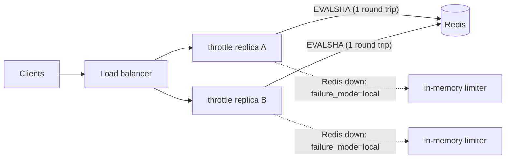

# Throttle

[](https://github.com/tkpohar/throttle/actions/workflows/ci.yml)


**A distributed rate-limiting service in Go.** Run as many stateless replicas as you like: they share limits through Redis, and every decision is a single atomic Lua script. If Redis goes down, a configurable failure mode keeps your API up.

```
POST /v1/check {"rule":"login","key":"user-42"}
→ 200 OK                  RateLimit-Remaining: 4
→ 429 Too Many Requests   Retry-After: 42
```

## Highlights

- **Two algorithms**: a **token bucket** (allows bursts, then a steady rate) and a **sliding-window counter** (smooth, with no burst at window edges). Each key uses O(1) memory.
- **Correct under concurrency**: Redis logic runs as an atomic Lua script, so there's no read-modify-write race. A test fires 1,000 concurrent requests at one key and checks that exactly `limit` get through.
- **Clock-skew safe**: scripts read `TIME` from Redis, so every replica agrees on what "now" is.
- **Redis Cluster ready**: each decision touches one hash-tagged key (`throttle:{rule}:{key}`).
- **Graceful degradation**: on backend errors you choose `open` (allow all), `closed` (deny all) or `local` (fall back to an in-memory limiter on each replica).
- **Observability**: a Prometheus `/metrics` endpoint (decisions, latency histogram, backend errors), structured JSON logs, and `/healthz` and `/readyz` probes.
- **Use it as a service or a library**: there's an HTTP decision API, and you can also embed `pkg/limiter` plus the `pkg/middleware` net/http middleware.
- **Production hygiene**: graceful shutdown, server timeouts, request-size limits, a distroless non-root image, and CI with the race detector running against real Redis.

## Architecture



Your API gateway or service calls `POST /v1/check` before handling a request. Or it can skip the network hop and embed the limiter directly:

```go
lim := limiter.NewRedis(redis.NewClient(&redis.Options{Addr: "localhost:6379"}))
rule := limiter.Rule{Name: "api", Algorithm: limiter.TokenBucket, Limit: 100, Window: time.Minute, Burst: 20}
http.ListenAndServe(":8080", middleware.RateLimit(lim, rule, middleware.ByHeader("X-API-Key"))(mux))
```

## Quick start

```bash
# Single process, in-memory backend
make run

# Full distributed setup: 2 replicas + Redis
make demo
```

`make demo` sends alternating requests to two replicas. The 6th request is rejected even though it hits a different replica than the 5th, because the limit is shared:

```
request 5 -> replica :8081 -> HTTP 200  {"allowed":true,"limit":5,"remaining":0,...}
request 6 -> replica :8082 -> HTTP 429  {"allowed":false,"limit":5,"remaining":0,"retry_after_ms":41913.2,...}
```

## API

| Method | Path | Description |
|---|---|---|
| `POST` | `/v1/check` | Body `{"rule": string, "key": string, "cost"?: int}`. Returns **200** if allowed, **429** if limited, **404** for an unknown rule, **422** if `cost` is more than the rule can ever grant, and **503** if no decision could be made. When Redis is down, the configured failure mode decides the response instead. |
| `GET` | `/v1/rules` | Lists the configured rules. |
| `GET` | `/metrics` | Prometheus exposition. |
| `GET` | `/healthz` | Liveness. |
| `GET` | `/readyz` | Readiness (pings Redis). |

Responses include the `RateLimit-Limit`, `RateLimit-Remaining` and `RateLimit-Reset` headers (from the IETF draft) and, on a 429, `Retry-After`.

## Configuration

See [`config.example.json`](config.example.json). Environment variables override the file: `THROTTLE_CONFIG`, `THROTTLE_LISTEN_ADDR`, `THROTTLE_BACKEND` (`redis` or `memory`), `THROTTLE_REDIS_ADDR`, `THROTTLE_FAILURE_MODE` (`open`, `closed` or `local`).

```json
{ "name": "api-default", "algorithm": "token_bucket",   "limit": 100, "window": "1m", "burst": 20 }
{ "name": "login",       "algorithm": "sliding_window", "limit": 5,   "window": "1m" }
```

## Performance

Measured with `make bench` on a 2-vCPU cloud VM, with Redis on localhost:

| Benchmark | ns/op | allocs/op |
|---|---|---|
| In-memory token bucket (parallel, 1,024 keys) | ~227 | 2 |
| In-memory sliding window (parallel, 1,024 keys) | ~198 | 2 |
| Redis token bucket (parallel, 1,024 keys) | ~43,000 (one network round trip) | 20 |

The in-memory backend uses 64 lock shards to reduce contention. With Redis, the round trip dominates, so throughput scales with Redis rather than with the replicas.

## Testing

```bash
make test         # unit tests with -race
make test-redis   # + Redis integration tests (needs Redis on :6379)
```

Coverage is about 90% across the limiter, server, config and middleware packages. A fake clock makes the algorithm tests deterministic. Notable tests:

- `TestSlidingWindowNoBoundaryBurst` checks that the classic fixed-window flaw (2× the limit across a window boundary) can't happen.
- `TestRedisConcurrentExactlyLimit` sends 1,000 goroutines at one key and checks that exactly 100 are admitted, for both algorithms.
- `TestFailoverModes` covers the open, closed and local behavior when the backend fails.

## Design decisions

See [docs/DESIGN.md](docs/DESIGN.md) for the trade-offs: the algorithm choice, why the scripts use Lua instead of `MULTI`, the clock source, cluster compatibility, failure modes, and what I'd build next.

## Project layout

```
cmd/throttle/         service entrypoint (config, wiring, graceful shutdown)
pkg/limiter/          algorithms, in-memory and Redis backends, failover, Lua scripts
pkg/middleware/       net/http middleware for embedding
internal/server/      HTTP API + Prometheus metrics
internal/config/      JSON config + env overrides + validation
```

## License

MIT
